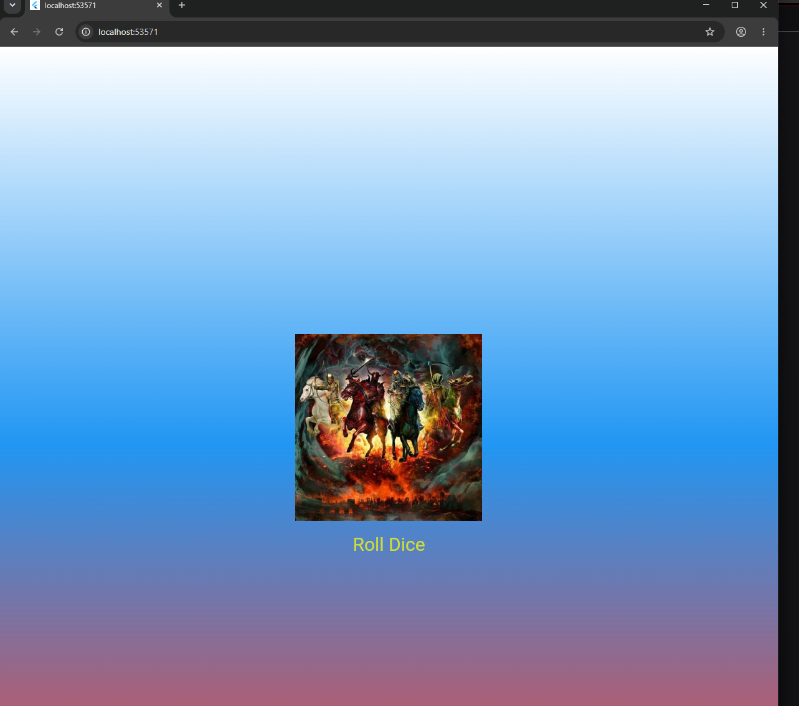

# Лабораторная работа №4-5. Flutter.

**ФИО: Глазков Александр Юрьевич**
**Группа: ИСП-242**
**Дата сдачи: 1.11.2026**

## Что изучили:
1. Полностью поняли отличия StatelessWidget от StatefulWidget.
2. Благодаря setState() смогли управлять состоянием интерфейса.
3. Была выполнена генерация случайных чисел,которые используются в игре кости.

## Скриншот финального приложения:

## Ссылка на репозиторий:

[GitHub](https://github.com/cocos812/Flutter_Widgets.git)

## Инструкция по запуску:

1. Склонируйте репозиторий.
2. Выполните `flutter pub get` для установки зависимостей.
3. Запустите приложение командой `flutter run`.

## Ответы на вопросы:
1. Разделение кода повышает его читаемость, облегчает навигацию и обеспечивает повторное использование компонентов. Хранение всей логики в main.dart приведёт к разрастанию файла до нескольких тысяч строк, что усложнит отладку и внесение правок.
2. Это структура, фиксирующая позицию виджета в дереве элементов. Flutter передаёт её неявно; она необходима для доступа виджета к данным, предоставляемым родительскими компонентами.
3. StatelessWidget рендерится единожды и остаётся неизменным. StatefulWidget поддерживает внутреннее состояние и способен инициировать перерисовку через setState() при его модификации.
4. Инициализация Random() внутри обработчика нажатия кнопки приводит к созданию нового экземпляра генератора при каждом вызове — это снижает производительность. Оптимально объявить один экземпляр Random на уровне файла для многократного использования.
